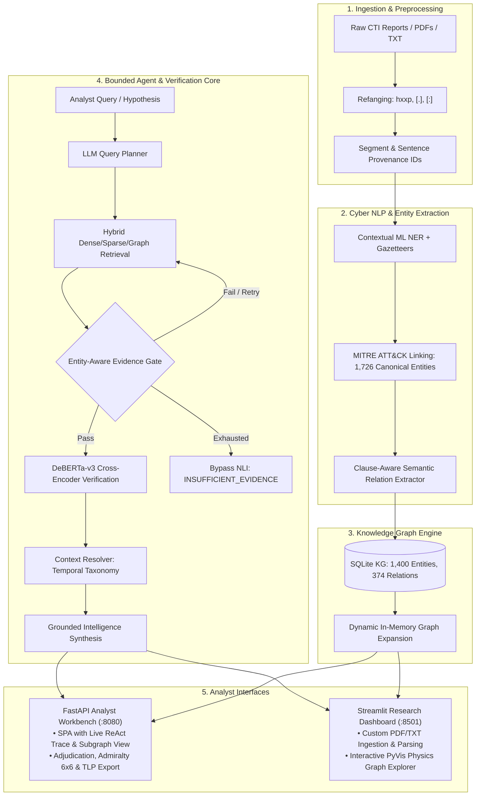

# ThreatIntel: Evidence-Verified Cyber Threat Intelligence

> **Knowledge-Graph Augmented Retrieval, Cross-Encoder NLI Evidence Verification, and Context-Aware Contradiction Resolution**

[](https://www.python.org/downloads/)
[](demo/)
[](https://pytorch.org/)
[](https://huggingface.co/cross-encoder/nli-deberta-v3-base)
[](tests/)
[](LICENSE)

---

## Quickstart (Under 2 Minutes)

```bash
# 1. Clone & install
git clone https://github.com/joshi-006/cyberrag.git
cd cyberrag
python -m venv venv
.\venv\Scripts\activate       # Windows (or: source venv/bin/activate on Linux/macOS)
pip install -r requirements.txt

# 2. Launch Analyst Workbench
python demo/server.py
```
Open **[http://localhost:8080](http://localhost:8080)** in your browser for the full interactive CTI Analyst Command Center.

---

## 1. What is ThreatIntel?

Standard LLMs and naive RAG pipelines hallucinate threat actor relationships, misidentify reporting vendors as attackers, and treat syndicated duplicate articles as independent consensus. 

**ThreatIntel** provides an end-to-end, provenance-preserving verification system for Cyber Threat Intelligence:

* **Hallucination Prevention**: Strictly enforces entity-level co-occurrence gating so ungrounded entities are never evaluated as true relations.
* **Natural Language Inference (NLI)**: Uses `cross-encoder/nli-deberta-v3-base` to verify claims against primary report text with calibrated semantic entailment scores.
* **Temporal Supersedence**: Distinguishes factual errors from operational shifts over time (e.g., when a threat actor discontinues malware after an infrastructure takedown).
* **Syndication Deduplication**: Identifies identical reporting across multiple publishers to prevent false consensus.
* **Provenance Audit Trail**: Every verdict links directly to verbatim sentences, publication dates, and source publishers.

---

## 2. System Architecture



---

## 3. Analyst Toolkit

The platform provides a comprehensive suite of CTI analysis tools, accessible both via the **Analyst Workbench UI** (`http://127.0.0.1:8080`) and as **REST API endpoints** (`/api/v1`):

| Tool | UI Action | Endpoint | Description |
| :--- | :--- | :--- | :--- |
| **Claim Verification** | Search box | `POST /api/investigate` | Evaluates a single threat claim with bounded hybrid retrieval, entity gating, and NLI verification. |
| **Verdict Time Machine** | Slider under verdict | `GET /api/v1/timetravel` | Replays verification historically as of any evidence publication date: *"What did reports state on day X?"* |
| **Connect Entities** | *Connect entities* | `POST /api/v1/connect` | Finds weighted shortest paths between two entities (e.g., *Emotet → Cobalt Strike ← TrickBot*), penalizing generic hubs. |
| **Entity Comparison** | *Compare* | `POST /api/v1/compare` | Side-by-side matrix comparing 2–3 actors/malware (targets, tools, techniques) with ATT&CK Navigator export. |
| **Report Fact-Check** | *Fact-check a report* | `POST /api/v1/factcheck` | Extracts claims from an unvetted report and cross-references against the corpus without self-corroboration. |
| **IOC Extractor** | *Extract IOCs* | `POST /api/v1/iocs` | Refangs `hxxp`/`[.]` and extracts IPs, domains, hashes, and CVEs; exports CSV or STIX 2.1 bundles. |
| **Batch Verification** | *Batch verify* | `POST /api/v1/batch` | Bulk verification of up to 25 claims per run with CSV export. |
| **Analyst Review & Export** | Review panel | `POST /api/export_brief` | Adjudicates verdicts with Admiralty 6×6 ratings and exports TLP-labeled briefs (`.md`) or STIX 2.1 bundles. |

---

## 4. Key Capabilities & Scenarios

The platform includes pre-configured scenarios demonstrating its core capabilities:

1. **Confirmed Use** (`Does APT28 use Zebrocy?`): Multi-sentence confirmation across independent reports.
2. **Confirmed Target** (`Does APT28 target NATO?`): Co-occurring actor-target verification in the same clause.
3. **Changes Over Time** (`Does Emotet use TrickBot?`): Earlier delivery reports superseded by later law-enforcement infrastructure takedown intelligence (temporal supersedence).
4. **Suspected Link** (`Does Lazarus target banks?`): Detects epistemic hedging words (*"might link"*, *"suspected"*) and flags the claim as tentative rather than confirmed.
5. **No Evidence** (`Does Sandworm use Cyclops Blink?`): Safely declines to answer rather than hallucinating when entities are missing from the corpus.
6. **Citation Guard** (`Does Turla use Zebrocy?`): Filters out bibliography sections and footnote lists to prevent false positive attribution.

---

## 5. Corpus & Knowledge Graph Metrics

| Metric | Count | Details |
| :--- | :---: | :--- |
| **Indexed Passages** | **5,992** | Extracted from 104 threat reports across 2,698 paragraphs with full provenance metadata. |
| **Graph Entities** | **1,400** | Canonical threat actors, malware families, tools, CVEs, techniques, and organizations. |
| **Graph Relations** | **374** | Relation assertions (`TARGETS`, `USES`, `USES_TECHNIQUE`) stored in SQLite (`data/cti_kg.db`). |
| **MITRE ATT&CK Registry** | **1,726** | Canonical definitions from Enterprise ATT&CK Matrix (178 Actors, 747 Malware, 95 Tools, 706 Techniques). |
| **Dense Embeddings** | **9.2 MB** | 384-dimensional dense vectors (`all-MiniLM-L6-v2`) precomputed for cold-start performance. |

<details>
<summary><b>Click to expand: Methodological Rigor & Human Annotation Study Details</b></summary>

All 374 stored assertions carry `trust_level: "unverified"` and `human_verified: false`, reflecting automated clause-aware syntactic extraction.

To measure real-world precision, a formal double-annotator human study was conducted on 100 randomly sampled relations (seed 42) from 192 candidate relations across 36 reports:
* **Annotator A**: 31/100 correct (31.0%, 95% Wilson CI: 22.8%–40.6%)
* **Annotator B**: 40/100 correct (40.0%, 95% Wilson CI: 30.9%–49.8%)
* **Inter-Annotator Agreement**: 89/100 with Cohen's $\kappa = 0.76$ (substantial agreement); 30 rows agreed correct, bounding baseline relation precision between ~31% and ~40% (about one-third).
* **Common False Triples**: Entities co-occurring in the same passage without stating a relation (~37), incorrect entity boundaries (~19), reversed direction (2), and hypothetical/negated statements (1).
* **System Limits**: Real-world NER F1 = 0.4396 on the AnnoCTR benchmark; baseline relation precision is ~1/3; all automated assertions require human review before operational use.

</details>

---

## 6. Evaluation Benchmarks

| Benchmark Split | Precision | Recall | F1 Score | Protocol |
| :--- | :---: | :---: | :---: | :--- |
| **Baseline Gazetteer (AnnoCTR Test)** | 0.3668 | 0.3342 | 0.3497 | Exact lexical matching against MITRE ontology |
| **Contextual Hybrid NER (AnnoCTR Test)** | **0.3964** | **0.4933** | **0.4396** | Contextual sliding-window ML + Gazetteer + Aliases |
| **Controlled 50-Sentence Synthetic Test** | 0.8614 | 0.9355 | 0.8969 | Report-Level GroupKFold Cross-Validation |
| **Developer Generalization Check** | 0.9388 | 0.9020 | 0.9200 | Unseen test paragraphs (Volt Typhoon, AcidRain) |

*The AnnoCTR test split (3,059 sentences) has strictly 0% document overlap with training data, demonstrating a **+25.7% relative F1 gain** and **+47.6% recall improvement** over dictionary lookups on noisy real-world CTI.*

---

## 7. Running the Platform

### Option A: FastAPI Analyst Workbench (Recommended)
```bash
python demo/server.py
```
* Interactive web UI: `http://localhost:8080`
* Swagger REST API docs: `http://localhost:8080/docs`

### Option B: Streamlit Exploration Dashboard
```bash
streamlit run app.py
```
* Exploratory dashboard: `http://localhost:8501`

### Option C: Docker Container
```bash
docker build -t threatintel .
docker run -d -p 8080:8080 -p 8501:8501 threatintel
```

---

## 8. Running Tests

The test suite runs 100% offline using locally cached model weights:

```bash
# Run complete test suite (153 tests: unit, integration, analyst tools, REST API)
python -m pytest

# Run fast modular test suite
python -m pytest tests/test_analyst_tools.py tests/test_manifest_hash.py

# Run legacy test runner (85 tests)
python run_tests.py
```

---

## 9. Citations & Attribution

* **AnnoCTR Corpus**: Bosch Research, *AnnoCTR: A Dataset for Detecting and Linking Entities, Tactics, and Techniques in Cyber Threat Reports* (LREC-COLING 2024), licensed under **CC BY-SA 4.0**. See [NOTICE.md](NOTICE.md).
* **MITRE ATT&CK**: The MITRE Corporation Enterprise ATT&CK Matrix (STIX 2.1).
* **Models**: `sentence-transformers/all-MiniLM-L6-v2` & `cross-encoder/nli-deberta-v3-base`.

---

## 10. License

This project is licensed under the **Apache License, Version 2.0**. See [LICENSE](LICENSE) for full details.
