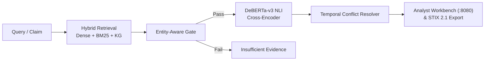

# ThreatIntel

> **Evidence-Verified Cyber Threat Intelligence using Knowledge Graphs and Cross-Encoder NLI.**

[](https://www.python.org/downloads/)
[](demo/)
[](https://huggingface.co/cross-encoder/nli-deberta-v3-base)
[](tests/)
[](LICENSE)

---

## ⚡ Quickstart

```bash
# Clone & install
git clone https://github.com/joshi-006/cyberrag.git
cd cyberrag
pip install -r requirements.txt

# Launch Analyst Workbench
python demo/server.py
```
Open **[http://localhost:8080](http://localhost:8080)** in your browser.

---

## 🎯 Key Features

* **Zero Hallucination**: Entity-aware gating screens ungrounded entities before evaluation.
* **DeBERTa-v3 Verification**: Cross-encoder NLI provides calibrated entailment scores for every claim.
* **Temporal Supersedence**: Distinguishes factual errors from operational shifts (e.g., malware takedowns).
* **Deduplication**: Suppresses syndicated duplicate news to prevent false vendor consensus.
* **Analyst Adjudication**: Admiralty 6×6 reliability ratings and TLP v2.0 evidence brief export (`.md` / STIX 2.1).

---

## 🛠️ Analyst Toolkit

| Tool | Endpoint | Description |
| :--- | :--- | :--- |
| **Claim Verifier** | `POST /api/investigate` | Verifies threat claims with sentence-level citations. |
| **Entity Questions** | `POST /api/v1/ask` | Answers open questions (e.g. *"What does APT28 target?"*). |
| **Claim Watchlist** | `POST /api/check_claims` | Watches claims and alerts when newly added reports alter verdicts. |
| **Time Machine** | `GET /api/v1/timetravel` | Replays intelligence verdicts historically as of any date. |
| **Connect Entities** | `POST /api/v1/connect` | Shortest relation chains between two actors/malware. |
| **Compare** | `POST /api/v1/compare` | Side-by-side matrix of shared tools, targets & techniques. |
| **Fact-Check** | `POST /api/v1/factcheck` | Cross-checks unvetted reports against the corpus. |
| **IOC Extractor** | `POST /api/v1/iocs` | Extracts and defangs IPs, domains, CVEs & hashes. |
| **Batch Verify** | `POST /api/v1/batch` | Verifies up to 25 claims per run with CSV export. |
| **Print / PDF Brief** | Browser Print | Printable investigation brief with timeline and evidence quotes. |

---

## 🏗️ Architecture



---

## 📊 Benchmark Results

| Model | Precision | Recall | F1 Score | Evaluation Split |
| :--- | :---: | :---: | :---: | :--- |
| **Gazetteer Dictionary** | 0.3668 | 0.3342 | 0.3497 | AnnoCTR Test (3,059 sentences) |
| **ThreatIntel Hybrid NER** | **0.3964** | **0.4933** | **0.4396** | AnnoCTR Test (+25.7% F1 gain) |
| **Test Suite** | **160 / 160 Passing** | — | — | Full offline pytest suite |

---

## 🧪 Testing

```bash
# Run complete test suite (160 tests)
python -m pytest
```

---

## 📜 License

Apache License 2.0. See [LICENSE](LICENSE) and [NOTICE.md](NOTICE.md) for corpus attribution (AnnoCTR / CC BY-SA 4.0).
