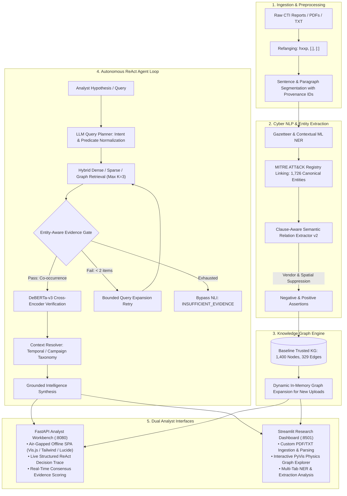

# CyberRAG: Provenance-Preserving CTI Knowledge Graph & Verification Platform

> **Graph-Augmented Retrieval, Cross-Encoder NLI Evidence Verification, and Context-Aware Contradiction Resolution for Cyber Threat Intelligence**

[](https://www.python.org/downloads/)
[](demo/)
[](https://streamlit.io/)
[](https://pytorch.org/)
[](https://huggingface.co/cross-encoder/nli-deberta-v3-base)
[](tests/)

---

## 1. Executive Summary & Core Motivation

Cyber Threat Intelligence (CTI) analysis requires synthesizing complex, multi-source reporting to track threat actors, malware strains, exploited vulnerabilities (CVEs), and attack infrastructure. However, deploying standard Large Language Models (LLMs) and naive Retrieval-Augmented Generation (RAG) pipelines in CTI introduces severe operational risks:

1. **Hallucination & Ungrounded Triples**: Standard LLMs infer non-existent threat actor relationships or fabricate CVE-malware links without verifiable textual grounding.
2. **False Consensus from Duplicate Reporting**: In open-source CTI, multiple reporting vendors frequently syndicate, quote, or rewrite the exact same underlying sentence. Standard vector retrieval aggregates these duplicates, mistaking repetitive syndication for independent corroborating consensus.
3. **Temporal Naivety in Contradiction Handling**: Threat intelligence changes dynamically over time. When an earlier report (e.g., October 2020) states *"Emotet delivers TrickBot"* and a later post-takedown report (e.g., May 2021) observes that Emotet infrastructure ceased distributing TrickBot, standard NLI and semantic retrieval flag this as a factual contradiction (`CONTRADICTED`), rather than recognizing an operational shift (**Temporal Supersedence**).
4. **Attribution Drift & Vendor Targeting**: Naive relationship extractors frequently mistake reporting cybersecurity vendors (e.g., *Mandiant*, *CrowdStrike*, *Zscaler*) or spatial descriptors (e.g., *across Europe*) for threat actors or victim targets.

**CyberRAG** solves these challenges by combining a structured, typed **Cyber Knowledge Graph**, **Hybrid Dense/Sparse/Graph Retrieval**, cross-encoder **Natural Language Inference (NLI)** verification with duplicate-aware provenance tracking, and an automated **Context-Aware Contradiction Resolver**.

---

## 2. Integrated System Architecture

CyberRAG operates as a multi-stage, provenance-preserving pipeline integrating a bounded ReAct retrieval agent, a typed knowledge graph, and dual analyst interfaces:



### Component Breakdown
| Subsystem | Modules | Core Responsibility |
| :--- | :--- | :--- |
| **Data Ingestion** | `src/dataset/`, `src/preprocessor/` | Defangs network indicators (`hxxp[:]//`), performs NFKC unicode normalization, and segments text into 5,991 segments across 2,698 paragraphs with immutable provenance metadata (`report_id`, `source`, `publication_date`, `sentence_id`). |
| **Cyber NLP** | `src/nlp/` | Extracts 7 entity categories (*ThreatActor, Malware, Tool, CVE, Technique, Organization, Location*). Resolves aliases to 1,726 canonical MITRE ATT&CK entries. Clause-aware extractor extracts `USES`, `TARGETS`, `EXPLOITS`, and `USES_TECHNIQUE` while filtering reporting vendors and spatial prepositions. Preserves negative assertions (`polarity="negative"`) with full evidence grounding. |
| **Knowledge Graph** | `src/graph/` | Manages the baseline 1,400-node, 329-edge NetworkX Knowledge Graph. Supports in-memory dynamic expansion for live uploads without corrupting the baseline on disk. |
| **Analyst Agent & Verification Core** | `src/agent/`, `src/core/` | Coordinates bounded ReAct retrieval and structured verification workflows (`CyberRAGAgent`, `VerificationService`, `EntityAwareEvidenceGate`, `QueryPlanner`). Enforces entity-grounded gating, screens ungrounded entities, and generates structured decision traces. |
| **Hybrid Retrieval** | `src/retrieval.py`, `src/graph_retrieval.py` | Combines 384-dimensional dense semantic embeddings (`sentence-transformers/all-MiniLM-L6-v2`), BM25 token matching, and entity-linked graph assertion lookups. |
| **Evidence Verification** | `src/verification/` | Employs `cross-encoder/nli-deberta-v3-base` to evaluate hypothesis alignment against retrieved evidence. Softmax scores represent textual alignment rather than empirical certainty. Suppresses intra-vendor duplicate passages. |
| **Context Resolver** | `src/verification/context_resolver.py` | Classifies conflicting intelligence into a 4-tier CTI contradiction taxonomy: `TEMPORAL_SUPERSEDENCE`, `CAMPAIGN_DIVERGENCE`, `GENUINE_ATTRIBUTION_DISPUTE`, or `AMBIGUOUS_CONFLICT`. |
| **FastAPI Workbench** | `demo/server.py`, `demo/static/` | High-speed single-page application (`http://127.0.0.1:8080`) built with offline-bundled Tailwind, Vis.js, and Lucide. Features live structured decision traces, dynamic report ingestion, and local subgraph rendering. |
| **Streamlit Dashboard** | `app.py`, `src/ingestion.py` | Exploratory Streamlit interface (`http://127.0.0.1:8501`) supporting arbitrary PDF/TXT uploads, in-memory graph expansion, entity inspection tabs, and PyVis physics rendering. |

---

## 3. Knowledge Graph & Corpus Scale

The integrated baseline system operates over the following verified corpus metrics:

| Metric | Baseline Count | Description |
| :--- | :--- | :--- |
| **Baseline Graph Nodes** | **1,400** | Canonical threat actors, malware families, tools, CVEs, techniques, and sectors (combining MITRE ATT&CK ontology with extracted entities). |
| **Baseline Graph Edges** | **329** | Consolidated typed relational edges carrying multi-source provenance metadata. |
| **Baseline Assertions** | **374** | Discrete sentence-grounded relationship assertions with publication dates and sources. All records carry `trust_level: "unverified"` and `human_verified: false` denoting automated rule-based extraction without manual human review. |
| **Corpus Text Segments** | **5,991** | Paragraph- and sentence-level text chunks indexed across 2,698 paragraphs for dense and BM25 retrieval. |
| **MITRE ATT&CK Registry** | **1,726** | Canonical definitions ingested from STIX 2.1 Enterprise bundle (178 Actors, 747 Malware, 95 Tools, 706 Techniques). |
| **Precomputed Embeddings** | **9.2 MB** | 384-dim dense embeddings (`data/segment_embeddings_minilm.npy`) enabling instant cold starts. |

> **Note on Assertion Verification Status & Measured Human Relation Precision**:  
> In `data/assertions.jsonl`, each assertion record explicitly carries `"trust_level": "unverified"`, `"human_verified": false`, and `"verification_status": "unverified"`. These triples were generated via automated clause-aware syntactic extraction and entity-linking validation rules. They have not undergone manual line-by-line verification by a human intelligence analyst. The old file `outputs/reports/relation_sample_100_audit.json` was an automated rule-based self-check, not a measurement of accuracy.  
> Real-world relationship extraction precision was measured in a formal first-round double-annotator human study on a sample of 100 relations drawn at random (seed 42) from the extractor's 192 candidate relations in `extracted_relations.json` across 36 reports (this is distinct from the 374 stored baseline graph assertions). Two annotators evaluated each relation from the evidence sentence alone under original guidelines (which were later refined after the first round, though reported figures reflect original rules): Annotator A found 31/100 correct = 31.0% (95% Wilson CI 22.8%–40.6%) and Annotator B (revised sheet) found 40/100 correct = 40.0% (CI 30.9%–49.8%), after changing 3 labels from an initial 37% submission with κ = 0.82. Agreement was 89/100 with substantial Cohen's κ = 0.76; 11 disagreements remain unadjudicated. Both agreed correct on 30 rows, bounding precision between 30% and 41% (headline: "about one third"). Common errors (rows both marked incorrect): relation not stated (~37), wrong entity (~19), reversed direction (2), negated/hypothetical (1). The primary cause of false extractions is that entities appear in the same passage without the sentence stating the relation; a same-sentence constraint is future work. Breakdown by relation: TARGETS 8/27, USES 11/32, USES_TECHNIQUE 10/27, and EXPLOITS 1/3 (EXPLOITS too small to interpret). Extractor confidence scores do not separate correct from incorrect relations (mean 0.95 vs 0.91). System limits must be stated side by side: NER F1 0.4396 on AnnoCTR test (baseline 0.3497); relation precision about one third; 374 assertions automatically extracted and unreviewed; and no EXPLOITS edges in the baseline graph.

---

## 4. Key Architectural Decisions & Methodological Rigor

### A. Structured Evidence Reporting vs. Unconstrained LLM Generation
In high-stakes cybersecurity operations, unconstrained generative language models pose significant liability due to subtle hallucinations and ungrounded embellishment. CyberRAG's `AnswerGenerator` is deliberately designed to produce **structured, evidence-grounded intelligence syntheses** citing exact report IDs, sources, publication dates, and verbatim premise sentences, rather than generating free-form, unverified text.

### B. Precise Graph Retrieval (Entity-Linked Traversal)
Graph retrieval in CyberRAG is implemented as **entity-linked assertion lookup and multi-hop neighborhood traversal**. It indexes entities identified in the query, traverses adjacent extracted graph assertions, and pulls the underlying verbatim evidence sentences. It does not claim unbounded semantic graph reasoning; every graph triple is strictly bound to its ingested source sentence.

### C. NLI Alignment vs. Calibrated Factual Truth
Neural Natural Language Inference models output softmax probability distributions representing whether premise text *linguistically entails, contradicts, or remains neutral* to a hypothesis. CyberRAG explicitly treats these as **semantic textual alignment scores**, not calibrated probabilities of real-world historical fact. The platform separates linguistic NLI verification from the contextual domain logic that assesses source corroboration and temporal relevance.

### D. Multi-Publisher Corroboration & Duplicate Suppression
CTI vendors frequently syndicate identical sentences or cite the same primary disclosures. If two retrieved passages share identical text or originate from the same reporting publisher, CyberRAG flags them as duplicates. Rather than claiming "8 corroborating sources," the platform counts distinct reporting vendors (e.g., *Intel 471* and *Zscaler*) to prevent false consensus.

### E. Non-Destructive In-Memory Graph Expansion
When an analyst uploads a custom PDF or TXT report in the Streamlit application:
1. Cyber NLP extracts entities and relationships in real time.
2. Extracted intelligence is merged into an **in-memory session copy** of the Knowledge Graph.
3. Newly discovered entities glow in **neon cyan diamonds (`#00f5d4`)** on the canvas.
4. The baseline Knowledge Graph on disk (`data/cti_knowledge_graph_trusted.json`) remains completely pristine and immutable.

### F. Architectural Pipelines & The Simulated Demo Overlay
Both the FastAPI analyst workbench (`demo/server.py`) and the MCP verification service (`mcp_server`) honour the `CTI_LOAD_DEMO_OVERLAY` environment variable:

* **Production & MCP Server Default (`load_demo_overlay=False` / `CTI_LOAD_DEMO_OVERLAY=0`)**: The MCP server operates strictly on genuine, unmodified corpus evidence with **zero synthetic records injected**.
* **Interactive Analyst Workbench Default (`CTI_LOAD_DEMO_OVERLAY=1` via `run_demo.bat`)**: The workbench loads the simulated Europol/CISA takedown statement (`DEMO-CURATED-EUROPOL-2021-05-20-TAKEDOWN`) so that Preset 2 (Temporal Supersedence) works reliably out of the box during presentations. The workbench can also be launched on the clean corpus by passing `set CTI_LOAD_DEMO_OVERLAY=0`.

#### Pipeline Differences on "Emotet USES TrickBot" (MCP vs. Demo Workbench)
When comparing MCP and the demo workbench side by side, note that the two interfaces use distinct retrieval and verification pipelines:

1. **On the clean corpus (`CTI_LOAD_DEMO_OVERLAY=0`)**: The two interfaces can disagree:
   * **Demo Workbench (`CyberRAGAgent`)**: Verifies *"Emotet USES TrickBot"* as **`VERIFIED`** (7 supporting passages, 0 contradicting). The agent loop's clause-aware syntactic and entity gating requires co-occurring relational claims, safely suppressing an Intel 471 article title containing a negation from entering the candidate claim pool.
   * **MCP Server (`VerificationService`)**: Flags a **`CONFLICTING_EVIDENCE`** outcome categorized as an attribution dispute (106-day delta between reports). The core service's broader dense retrieval pool captures the Intel 471 article title (*"Emotet takedown is not like the Trickbot takedown"*), which the DeBERTa cross-encoder evaluates as a semantic contradiction against the positive hypothesis.
2. **With the simulated takedown record added (`CTI_LOAD_DEMO_OVERLAY=1`)**:
   * The workbench ingests the May 20, 2021 Europol/CISA disruption statement.
   * With this post-seizure evidence dated 233 days after the earliest September 29, 2020 delivery reports, the Context Resolver successfully triggers **`TEMPORAL_SUPERSEDENCE`** (233 days, `CONTRA_LATER`), correctly resolving that the contradiction represents an operational reality shift following international law-enforcement infrastructure disruption.

---

## 5. Demonstration Scenarios (Streamlit Presets)

The platform includes four pre-configured operational scenarios validating distinct capabilities using simulated demonstration reports modeled on primary intelligence publishers:

```
┌────────────────────────────────────────────────────────────────────────────────────────┐
│ Preset 1: APT28 Campaign Targeting NATO (Simulated QuoIntelligence-Style Report)       │
│ • Validates: Clause-aware extraction with spatial trigger suppression.                 │
│ • Result: APT28 USES Zebrocy (SUPPORTED); APT28 TARGETS NATO (SUPPORTED).              │
│ • Detail: "across Europe" suppressed from spatial targeting to prevent false targets.  │
│   Corroborated against QuoIntelligence reporting in the historical corpus.             │
├────────────────────────────────────────────────────────────────────────────────────────┤
│ Preset 2: Emotet Infrastructure Takedown (Simulated Europol / CISA-Style Report)       │
│ • Validates: Context-aware contradiction resolution over time.                         │
│ • Proposition: "Emotet USES TrickBot."                                                 │
│ • Historical Evidence (2020-09-29, Zscaler / Intel 471): Entailment (Emotet distributed) │
│ • Later Evidence (2021-05-20, Europol/CISA): Contradiction (Post-seizure disruption)    │
│ • Result: CONFLICTING_EVIDENCE -> TEMPORAL_SUPERSEDENCE (233 days, CONTRA_LATER).      │
│ • Interpretation: Operational shift over time, not a historical contradiction.        │
│ • Note on Simulated Evidence: The post-takedown contradiction relies on the simulated  │
│   Europol report (data/demo_overlay.jsonl), loaded only in demo mode                   │
│   (CTI_LOAD_DEMO_OVERLAY=1, +233d delta). The production MCP service runs strictly   │
│   on genuine corpus text by default (load_demo_overlay=False).                         │
├────────────────────────────────────────────────────────────────────────────────────────┤
│ Preset 3: TrickBot-Emotet Malware Delivery Partnership (Simulated Intel 471-Style)     │
│ • Validates: Distinguishing independent vendor consensus from duplicated text.         │
│ • Result: SUPPORTED across 2 distinct publishers (Intel 471 & Zscaler).                │
│ • Detail: 3 duplicated text passages identified and suppressed from consensus count.   │
├────────────────────────────────────────────────────────────────────────────────────────┤
│ Preset 4: Sandworm & Cyclops Blink (Simulated CISA / UK NCSC-Style Report)             │
│ • Validates: Dynamic graph expansion + Entity-relevance evidence filtering.            │
│ • Graph Result: In-memory expansion (+2 nodes: Sandworm, Cyclops Blink; +5 edges).     │
│ • Verification Result: INSUFFICIENT_EVIDENCE (No matching evidence in baseline corpus). │
│ • Entity Filter: Irrelevant corpus passages (e.g. Taurus sandbox evasion) are          │
│   prevented from falsely scoring as contradictions on novel entities.                  │
└────────────────────────────────────────────────────────────────────────────────────────┘
```

---

## 6. Evaluation Framework & Benchmark Results

To maintain scientific integrity, evaluation metrics are segregated by benchmark protocol rather than conflated:

### 6.1 Primary Real-World Empirical Benchmark (AnnoCTR Corpus)
Evaluated directly against the official Bosch Research train (`ner_train.jsonl`, 7,570 sentences) and test (`ner_test.jsonl`, 3,059 sentences) splits with strictly **0% document overlap and zero leakage**:

| Model Architecture | Precision | Recall | F1 Score | Evaluation Protocol |
| :--- | :---: | :---: | :---: | :--- |
| **Baseline Gazetteer / Dictionary** | 0.3668 | 0.3342 | 0.3497 | Exact lexical matching against MITRE ontology |
| **Hybrid Contextual ML NER** | **0.3964** | **0.4933** | **0.4396** | Contextual sliding-window ML + Gazetteer + Aliases |
| **Relative Performance Delta** | **+8.1%** | **+47.6%** | **+25.7%** | Demonstrates substantial recall and discovery gain on noisy real-world CTI |

*This is the primary real-world benchmark. Performance on raw, unconstrained CTI text is F1 = 0.4396, reflecting the substantial difficulty of real-world threat reports (inconsistent terminology, complex nested clauses, and novel out-of-vocabulary threat actor handles). The hybrid model demonstrates a clear +25.7% relative F1 gain and +47.6% recall improvement over dictionary lookups on document-disjoint real-world test data.*

### 6.2 Controlled Pattern Extraction Test (Synthetic 50 Sentences)
* **Dataset**: A 50-sentence synthetic challenge benchmark (`data/benchmark/gold_standard_annotations.json`) designed to evaluate rule precision under ideal canonical entity representation.
* **Protocol**: Report-Level GroupKFold Cross-Validation (Leave-One-Report-Out across 6 report groups).
* **Results**: Precision = **0.8614**, Recall = **0.9355**, Overall F1 = **0.8969**.
* **Scope Note**: This score measures rule engine coverage under controlled conditions; it should not be conflated with the real-world AnnoCTR benchmark above.

### 6.3 Developer Test Paragraphs (Generalization Check)
* **Dataset**: 4 short developer-written test paragraphs (`data/unseen_reports/unseen_cti_reports.json`) containing 49 entity mentions and novel threat actors/malware (e.g., *Volt Typhoon*, *AcidRain*).
* **Results**: Precision = **0.9388**, Recall = **0.9020**, Overall F1 = **0.9200**.
* **Provenance Verification**: **100.0%** metadata compliance (zero missing report IDs, timestamps, or sentence references).

### 6.4 Archived Exploratory Retrieval Ablation (Methodological Note)
An exploratory retrieval ablation comparing baseline hybrid retrieval, LLM query rewriting, and agentic gating was developed during earlier prototyping (archived to `outputs/legacy/evaluate_llm_rag_ablation.py` and `outputs/legacy/llm_rag_retrieval_ablation.json`). 

> [!NOTE]
> **Methodological Review & Archival**: Methodological review determined that the exploratory v5 retrieval ablation contained a circular dependency: the same hand-curated alias mapping (`KNOWN_ALIASES`) used to generate retrieval gold labels was supplied to the expanded retrieval loop. Consequently, the reported metrics do not represent an unbiased measurement of real-world retrieval quality. Following rigorous empirical standards, this experiment has been archived to `outputs/legacy/` and should not be cited as empirical evidence. A sound, un-aliased retrieval ablation on independent benchmarks (such as AZERG) is documented as planned future work.

### 6.5 Unit & Integration Test Suite (100% Passing)
The entire test suite covers all pipeline stages including VerificationService and MCP server contracts (evaluated live via `python run_tests.py` across 16 suites):
```
Ran 79 tests in 75.6s
OK
```
*Note: All 79 tests run 100% offline using locally cached model weights (`cross-encoder/nli-deberta-v3-base` and `all-MiniLM-L6-v2`) without external network dependencies.*

---

## 7. Installation & Quickstart

### Prerequisites
* Python 3.10+ (tested on Python 3.10, 3.11)
* Git
* Internet connection (for initial Hugging Face model downloads)

### Local Setup
```bash
# 1. Clone repository
git clone https://github.com/joshi-006/cyberrag.git
cd cyberrag

# 2. Create and activate a virtual environment
python -m venv venv
# On Windows:
.\venv\Scripts\activate
# On Linux/macOS:
source venv/bin/activate

# 3. Install dependencies
pip install --upgrade pip
pip install -r requirements.txt
```

### Launch the Platform

#### Option A: Launch CyberRAG Analyst Workbench (FastAPI + Modern SPA)
```bash
python demo/server.py
```
Open `http://localhost:8080` in your browser for the full interactive CTI Analyst Command Center, featuring the live Bounded ReAct decision trace, Knowledge Graph canvas, DeBERTa NLI probability gauges, custom report ingestion, and one-click benchmark scenarios.

#### Option B: Launch Streamlit Dashboard
```bash
streamlit run app.py
```
Open `http://localhost:8501` in your browser. Select any of the preset scenarios or upload an arbitrary CTI PDF/TXT report.

### Verdict Time Machine
Every verdict in the workbench gets a **time machine**: a date slider whose stops are the publication dates of the evidence. Each stop re-runs verification with `as_of_date`, using only reports published on or before that day, and shows which passages appeared on that date; the play button replays the whole history. It answers "what did the reports say when this decision was made?". The time machine uses the core `VerificationService` (the same engine as the API and MCP server), whose conflict label can differ from the workbench agent's banner. Endpoint: `GET /api/v1/timetravel` (returns the stops; each is fetched with `POST /api/v1/verify_claim` and `as_of_date`).

### Connection Finder and Comparison
- **Connect entities** (`POST /api/v1/connect`): the shortest chains of relations linking two entities in the knowledge graph (up to 5 hops). Paths through generic hubs such as "government" are weighted down so specific links come first. Every hop shows its source sentence, publisher and date, and whether the NLI verifier finds that the text states it; the paths are drawn on a graph with the selected path highlighted. Example: *Emotet → Cobalt Strike ← TrickBot → Ryuk*.
- **Compare** (`POST /api/v1/compare`, `?format=csv` / `?format=layer`): 2-3 actors or malware families side by side as a matrix of what they use, are used by, target, exploit and which ATT&CK techniques they share, with the source sentence on every cell. Exports CSV and an ATT&CK Navigator layer scored by how many of the entities use each technique.
- Both resolve names and aliases the same way as verification; `GET /api/v1/entities` lists the 277 linked entities for autocomplete. Relations are automatic and unreviewed, so both views link every item to a full investigation.

### Analyst Tools (Workbench + REST API)
The workbench (`python demo/server.py`) adds these analyst tools on top of claim verification. Each one is also available as a REST endpoint under `/api/v1` (interactive docs at `http://127.0.0.1:8080/docs`).

| Tool | Where in the workbench | Endpoint | What it does |
| :--- | :--- | :--- | :--- |
| **Report fact-check** | *Fact-check a report* | `POST /api/v1/factcheck` | Extracts the relationship claims in a new report (paste text or load PDF/TXT/MD/HTML) and checks each against the baseline corpus: `CORROBORATED`, `CONTRADICTED_BY_CORPUS`, `DISPUTED`, or `NEW_INTEL`. The report is never added to the corpus, so it cannot corroborate itself. |
| **IOC extractor** | *Extract IOCs* | `POST /api/v1/iocs` (`?format=csv` / `?format=stix`) | Refangs `hxxp` / `[.]` and pulls IPv4s, domains, URLs, e-mails, MD5/SHA-1/SHA-256 and CVEs. Private IPs, file names and well-known reference sites are listed separately with the reason. Exports CSV or STIX 2.1 Indicators. |
| **Batch verification** | *Batch verify* | `POST /api/v1/batch` (`?format=csv`) | Up to 25 claims per run, as `APT28 \| USES \| Zebrocy`, CSV rows, or questions. Returns a verdict table; click a row to open the full investigation. |
| **Analyst brief** | *Download brief (.md)* on any verdict | `POST /api/v1/export/brief` | Markdown brief with verdict, evidence quotes, sources, dates, conflict resolution, decision trace and stated limits. Report text is escaped so it cannot inject formatting. |
| **STIX 2.1 export** | *Export STIX 2.1* on any verdict | `POST /api/v1/export/stix` | Validated bundle: supported claims become Relationships; every verdict is kept as a Note with evidence references. |
| **Entity profile** | Click a node in the graph | `GET /api/v1/entity/{name}` | Type, MITRE ID, aliases, first/last seen and graph links; clicking a link verifies it. |
| **ATT&CK Navigator layer** | Entity profile / fact-check results | `GET /api/v1/navigator/{name}`, `POST /api/v1/navigator/report` | Layer file for [MITRE ATT&CK Navigator](https://mitre-attack.github.io/attack-navigator/) scored by evidence count. Technique links are automatic and unreviewed, and the layer says so. |

The same `VerificationService` also backs `POST /api/v1/verify_claim`, `/verify_question`, `/search`, `GET /api/v1/timeline` and `/trace/{verification_id}`, so scripts and the MCP server get identical verdicts.

> Fact-check results inherit the relation extractor's limits (measured precision about one third, section 3): every row shows the report sentence it came from, and should be reviewed before it is acted on.

### Run the Test Suite
```bash
# Full suite (153 tests: unit, real-model end-to-end, REST API)
python -m pytest

# Legacy unittest runner (the unittest-style subset)
python run_tests.py
```

### Run Full Data & Knowledge Graph Verification
```bash
python verify_pipeline.py
```

---

## 8. Docker Deployment

CyberRAG includes a containerized build for cloud environments (AWS ECS, GCP Cloud Run, Azure App Service, or private servers):

```bash
# Build Docker image
docker build -t cyberrag .

# Run container (binds to port 8501)
docker run -d -p 8501:8501 --name cyberrag_app cyberrag
```
Access the application at `http://localhost:8501`.

---

## 9. Streamlit Community Cloud Deployment

To deploy this repository on [Streamlit Community Cloud](https://share.streamlit.io/):
1. Fork or push this repository to your GitHub account.
2. Sign in to **Streamlit Community Cloud**.
3. Click **"New app"** and specify:
   * **Repository**: `your-username/cyberrag`
   * **Branch**: `main`
   * **Main file path**: `app.py`
4. Click **"Deploy!"**. The platform will install dependencies from `requirements.txt` and launch automatically.

---

## 10. Known Limitations & Threats to Validity

To ensure scientific honesty and transparency, we document several known limitations of the current implementation:

1. **Origin & Sparsity of the 1,400-Node Baseline Graph**:
   The baseline Knowledge Graph (`data/cti_knowledge_graph_trusted.json`) contains **1,400 consolidated entity nodes extracted across the full 104-report corpus** (spanning 2016–2022), with **415 nodes linked to canonical MITRE ATT&CK IDs**. The nodes are connected by **329 unique relation edges** derived from the 374 assertions extracted across 62 of those reports (2018–2022). However, the graph is sparse: only 277 of the 1,400 nodes have an edge, while 1,123 nodes (80.2%) remain isolated because most entity mentions in raw text do not appear in supported syntactic relation clauses. Running `run_pipeline.py` over the 30 curated demonstration reports alone yields a localized 209-node subnetwork.
2. **Assertion Predicates & Missing EXPLOITS Instances**:
   The 374 assertions comprise only three relation types: `TARGETS` (184), `USES` (99), and `USES_TECHNIQUE` (91). While syntactic rules for `EXPLOITS` are implemented in the extractor, the baseline corpus contains zero extracted `EXPLOITS` instances, and only 9 CVE entity nodes exist in the baseline graph.
3. **Automated Rule-Filtering & Unverified Baseline Assertions**:
   The 374 assertions in the baseline Knowledge Graph were extracted using automated syntactic pattern rules and entity-linking validation filters. In `data/assertions.jsonl`, each assertion explicitly stores `trust_level: "unverified"`, `human_verified: false`, and `verification_status: "unverified"`. None of the 374 assertions have undergone line-by-line manual verification by a human intelligence analyst.
4. **Measured Real-World Relationship Precision (Human Annotation)**:
   While Named Entity Recognition was empirically benchmarked against the official AnnoCTR dataset (achieving an F1 of 0.4396 on real-world noisy text vs. 0.3497 baseline), **real-world relationship extraction precision was measured at about one third** in a formal double-annotator human study. The sample of 100 relations was drawn at random (seed 42) from the extractor's 192 candidate relations in `extracted_relations.json` across 36 reports (this is distinct from the 374 stored baseline graph assertions). Two annotators evaluated each relation from the evidence sentence alone under original guidelines (later refined after the first round, though reported figures reflect original rules): Annotator A marked 31/100 correct (31.0%, 95% Wilson CI 22.8%–40.6%) and Annotator B marked 40/100 correct (40.0%, CI 30.9%–49.8%, changing 3 labels from an initial 37% submission with κ=0.82). Inter-annotator agreement was 89/100 with substantial Cohen's κ = 0.76 (11 unadjudicated disagreements); both agreed correct on 30 rows (precision bounded between 30% and 41%, headline "about one third"). Common errors (rows both marked incorrect): relation not stated (~37), wrong entity (~19), reversed direction (2), and negated/hypothetical (1). The primary cause of false triples is that entities appear in the same passage without the sentence stating the relation; a same-sentence constraint is future work. Breakdown by relation: TARGETS 8/27, USES 11/32, USES_TECHNIQUE 10/27, and EXPLOITS 1/3 (too small to interpret). Extractor confidence scores do not separate correct from incorrect relations (mean 0.95 vs 0.91). System limits should be viewed side by side: NER F1 0.4396 on AnnoCTR test (baseline 0.3497); relation precision about one third; 374 baseline graph assertions automatically extracted and unreviewed; and no EXPLOITS edges in the baseline graph.
5. **Polarity of Baseline Assertions & Negation Handling**:
   All 374 historical assertions stored in the static baseline graph are positive relations (`polarity="positive"`). Syntactic negation handling (`polarity="negative"`) was implemented and validated for **live dynamic ingestion of counter-evidence** (e.g., post-takedown reports in Preset 2). Negative statements about past campaigns are rare in baseline vendor reporting, so historical negative assertions were not pre-extracted across the entire static baseline.
6. **Graph Retrieval Scope**:
   Graph retrieval is implemented as entity-linked assertion lookup and adjacent neighborhood traversal. It retrieves evidence-grounded triples connected to extracted query entities; it does not perform unconstrained multi-hop inductive reasoning over arbitrary unindexed graph paths.

---

## 11. Citation & Acknowledgments

* **AnnoCTR Corpus**: Bosch Research, *AnnoCTR: A Dataset for Detecting and Linking Entities, Tactics, and Techniques in Cyber Threat Reports* (LREC-COLING 2024). Portions of this dataset are used under the **CC BY-SA 4.0** license. See [NOTICE.md](NOTICE.md) for full attribution.
* **MITRE ATT&CK**: The MITRE Corporation Enterprise ATT&CK Matrix (STIX 2.1).
* **Sentence Transformers**: `sentence-transformers/all-MiniLM-L6-v2`.
* **NLI Cross-Encoder**: `cross-encoder/nli-deberta-v3-base`.

---

## 12. License

This project is licensed under the **Apache License, Version 2.0**. See the [LICENSE](LICENSE) file for complete terms. Third-party datasets (such as the Bosch Research AnnoCTR corpus under CC BY-SA 4.0) and external frameworks are attributed in [NOTICE.md](NOTICE.md).
